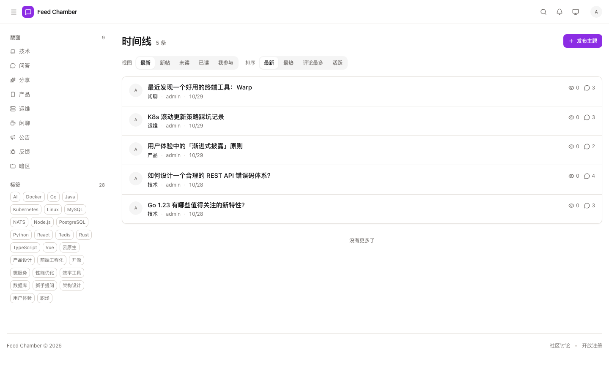
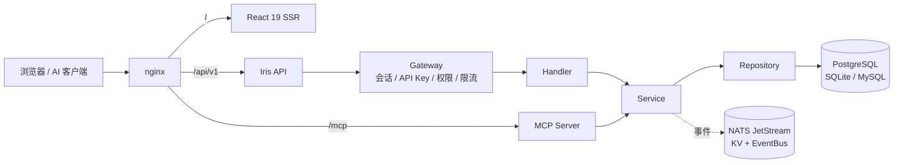

<p align="center">
  
</p>

<h1 align="center">Feed Chamber</h1>

<p align="center">
  可自托管的社区论坛 · Go + Iris 后端，React 19 前端<br />
  内建成长体系、可见性与门控、内容审核、站点自定义，以及 MCP 双向能力
</p>

<p align="center">
  <a href="https://github.com/NoelOrin/FeedChamber/actions/workflows/quality.yml"></a>
  <a href="https://github.com/NoelOrin/FeedChamber/actions/workflows/docs-pages.yml"></a>
  <a href="https://github.com/NoelOrin/FeedChamber/actions/workflows/docker-build.yml"></a>
  <a href="LICENSE"></a>
  
  
</p>

<p align="center">
  <a href="https://noelorin.github.io/FeedChamber/">文档</a> ·
  <a href="https://noelorin.github.io/FeedChamber/getting-started/">快速开始</a> ·
  <a href="https://noelorin.github.io/FeedChamber/reference/endpoints/">API 参考</a> ·
  <a href="CONTRIBUTING.md">贡献指南</a>
</p>



## 为什么是 Feed Chamber

- **会话即凭证**：登录签发服务端会话，登出 / 改密 / 改角色 / 封号都直接删行，不依赖黑名单。
- **XP 是行为聚合**：`total_xp = Σ(指标 × 当前规则) + 连续签到 + 人工调整`，删帖会自动回收，改分值立即对全员生效。
- **可见性与门控**：版面 `public` / `login` / `level` 三档，沿祖先链取最严；门控规则按优先级决定放行、拒绝、转审或限流。
- **两种入口一套逻辑**：REST、SSE、MCP 共用同一批 service 与同一个权限判据，不给机器入口开审核旁路。

## 能力一览

| 领域 | 内容 |
|------|------|
| 内容 | 树形版面、帖子、嵌套评论、标签、草稿、修订历史、回收站、置顶 / 锁定 / 精华 |
| 互动 | 点赞、收藏、关注、拉黑、主题订阅、私信、站内通知 + SSE |
| 认证 | 服务端会话、邮箱验证码、MFA（TOTP + 备份码）、OAuth 六家、OIDC SSO、API Key |
| 权限 | 61 个平台级权限码、版面级覆盖与继承、用户组、API Key scope |
| 治理 | 四种审核模式、审核队列、举报、两级禁言、封号、门控规则、审计日志 |
| 成长 | XP 聚合、等级定级 + 保级、签到、徽章、排行榜、人工调整 |
| 站点 | 主题 token、自定义 CSS/JS/HTML、导航、首页模块、自定义页面 |
| 集成 | 313 个 path / 314 个操作、SSE、Webhook（12 事件）、MCP Server / Client |

## 快速开始

需要 Docker Engine 与 Compose v2：

```bash
git clone https://github.com/NoelOrin/FeedChamber.git
cd FeedChamber

ADMIN_PASSWORD='换成你的密码' \
  docker compose -f deploy/docker-compose.yml up -d --build
```

打开 <http://localhost>，用 `admin` + 上面的密码登录；首次登录会强制改密。

没设 `ADMIN_PASSWORD` 时，密码会随机生成并打印在日志里：

```bash
docker compose -f deploy/docker-compose.yml logs backend | grep -i admin
```

完整的安装、端口、卷与升级说明见[快速开始](https://noelorin.github.io/FeedChamber/getting-started/)。

## 架构



- 后端严格单向分层：`handler → service → repository → database`，网关负责认证与授权。
- 会话、限流窗口、设置缓存与事件总线都在外部 NATS（JetStream）上，所以后端可水平扩副本。
- 前端与后台同源同构建：`/admin` 是主站的一段，不是独立应用。

```
app/server/          Go 后端（Iris、GORM、NATS）
app/web/             React 19 + vinext 前端（含 /admin）
app/docs/            Astro + Starlight 文档站（中英双语）
packages/            API client / SSE client / 共享工具 / 设计 token
deploy/              docker-compose、nginx、prometheus、grafana
```

## 本地开发

需要 Go 1.25+、Node.js 22+、pnpm 10+，以及一个启用了 JetStream 的 NATS：

```bash
docker run --rm -p 4222:4222 nats:2.10-alpine -js

pnpm install
cd app/server && NATS_URL=nats://127.0.0.1:4222 go run main.go -e dev
# 另一个终端
pnpm dev:web
```

细节见[本地开发](https://noelorin.github.io/FeedChamber/install/local/)。

## 文档

| 入口 | 内容 |
|------|------|
| [文档站](https://noelorin.github.io/FeedChamber/) | 安装、配置、管理、运维、API、MCP、参考（中英双语） |
| [端点索引](https://noelorin.github.io/FeedChamber/reference/endpoints/) | 由 `openapi.json` 生成的完整端点表 |
| [环境变量](https://noelorin.github.io/FeedChamber/reference/environment/) | 后端与前端读取的全部变量 |
| [错误码](https://noelorin.github.io/FeedChamber/reference/errors/) | 统一错误码与 HTTP 映射 |
| [`openapi.json`](openapi.json) | OpenAPI 3 规格（`make swag` 生成） |
| [`docs/`](docs/) | 内部工程材料：架构决策、评审、计划（不进文档站） |

## 参与贡献

- 提交前请读 [CONTRIBUTING.md](CONTRIBUTING.md)：分支模型、提交规范、CI 门禁与 PR 清单。
- 安全问题不要开公开 issue，见 [SECURITY.md](SECURITY.md)。
- 讨论请遵守 [CODE_OF_CONDUCT.md](CODE_OF_CONDUCT.md)。

## 许可证

[MIT](LICENSE) © 2026 NoelOrin

如果这个项目对你有帮助，欢迎点一个 ⭐。
